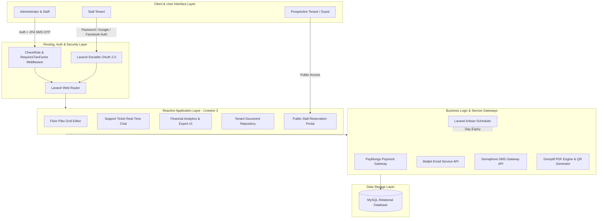
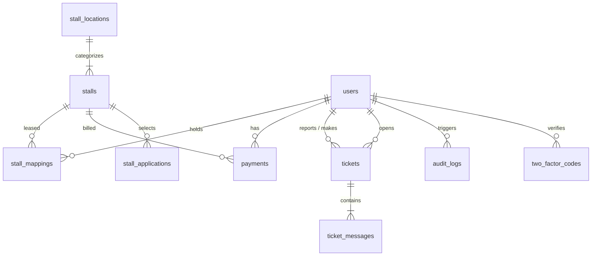

CHAPTER III
DESIGN AND METHODOLOGY

Requirement Analysis

To fully understand the operational needs of the client, the proponents conducted site visits, interviews, and direct observation at Center Point in Pagadian City, Zamboanga del Sur. These activities allowed the proponents to examine how stall management processes were currently performed across its floor levels, and to identify the inefficiencies associated with the existing manual system.

The gathered data revealed that stall assignments, tenant records, lease contracts, and payment tracking were primarily managed using logbooks and paper-based documentation. This approach often resulted in delays in processing transactions, difficulty in retrieving records, a higher risk of human error, and a lack of advance communication to tenants regarding approaching lease expiration dates. The absence of a centralized system limited transparency for tenants and made coordination between management and tenants less efficient.

The proponents also identified the absence of a formal online channel for prospective tenants to apply for stall rentals, a lack of a secure self-service document repository for existing tenants, insufficient security mechanisms for administrative accounts, and no centralized financial reporting tools for management decision-making.

The proponents applied structured observation, interviews, and document analysis to collect relevant data. Key operational issues identified include inefficient billing processes, the lack of an integrated digital payment system, limited tenant access to account information and documents, the absence of structured utility billing and lease expiry notifications, and unstructured communication between tenants and management.

The analysis of the collected data became the foundation for designing the Web Based Stall Management System for Center Point using Laravel 13.x and Livewire 3 to directly address all identified operational challenges.

Requirement Documentation

All gathered requirements were compiled into a System Requirements Document (SRD). The SRD serves as a formal and comprehensive record that outlines both the functional and non-functional requirements of the system. It establishes a clear agreement between the proponents and the client by defining expected system functionalities, user roles, system behavior, and operational limitations.

The SRD acted as the primary reference throughout the system development life cycle, guiding the design, development, testing, and deployment phases. The documented requirements include stall management, tenant management, lease contract tracking, lease expiry notification, automated billing and invoice generation, online and manual payment processing, utility billing, support ticket communication, document repository, public stall reservation, advanced financial reporting, social authentication (Google and Facebook), Two-Factor Authentication, dashboard reporting, audit logging, in-app notifications, and email and SMS dispatching.

Functional Requirements

The functional requirements of the Web Based Stall Management System for Center Point are as follows:

1. Provide a secure login system that authenticates users based on assigned roles (administrator, staff, and tenant), with support for Google OAuth 2.0 and Facebook OAuth social logins via laravel/socialite.
2. Provide optional Two-Factor Authentication (2FA) for administrator and staff accounts, requiring an SMS OTP code sent via Semaphore upon login when 2FA is enabled on the account.
3. Manage tenant registration, profiles, and account information including profile picture, phone number, and email verification.
4. Manage stall location records organized by floor level or zone.
5. Manage stall records, including floor plan grid positioning per floor, status (available, occupied, maintenance), monthly pricing, and description images.
6. Provide an interactive floor plan grid editor for administrators to configure and update stall positions per floor level.
7. Assign stalls to tenants through lease contracts with defined start and end dates and PDF contract document uploads.
8. Support lease renewal requests by tenants with administrator approval or rejection workflows.
9. Automatically notify administrators and tenants via Mailjet email and Semaphore SMS at 60 and 30 days before lease contract expiration dates.
10. Generate monthly rental invoices automatically for all active leases using a scheduled Artisan console command.
11. Dispatch multi-stage payment reminders via Mailjet email and Semaphore SMS at seven days, three days, and on the due date of each invoice.
12. Integrate online payment processing through the PayMongo API (GCash, Maya, credit cards, debit cards) with asynchronous webhook status verification.
13. Support manual office payment recording by administrators with custom reference IDs.
14. Generate official PDF payment receipts using Dompdf, featuring tenant details, billing information, and an embedded QR code for online authenticity verification.
15. Provide tenants with a self-service portal to view stall details, active lease information, payment history, and invoices.
16. Provide tenants with a secure document repository to access and download their lease contracts, payment receipts, and billing statements through IDOR-protected endpoints.
17. Record metered utility readings per tenant stall and compute corresponding utility billing charges.
18. Allow tenants to create, monitor, and participate in threaded support ticket conversations with file attachment support.
19. Enable administrators and staff to respond to, manage, and resolve support tickets with message threading and read receipts.
20. Provide an in-app notification center with real-time unread badge counters and mark-as-read functionality.
21. Provide a public-facing stall reservation portal for guest users, displaying available stalls and an online application form for prospective tenants.
22. Manage stall applications submitted through the reservation portal, allowing administrators and staff to review, approve, or reject applications.
23. Generate advanced financial reports including interactive revenue trend charts, stall occupancy rate analytics, overdue payment aging reports, and exportable CSV and PDF financial summaries.
24. Generate dashboard summaries and analytics for management.
25. Record all significant administrative actions in an audit log with user identity, action description, entity type and ID, timestamp, and IP address.

Non-Functional Requirements

The non-functional requirements ensure that the system performs efficiently, securely, and reliably. These include:

1. Operate as a web-based system accessible through modern web browsers without requiring client-side software installation, including the public-facing stall reservation portal accessible to unauthenticated users.
2. Respond to user interactions such as login, 2FA verification, payment processing, invoice generation, and report generation within an acceptable response time under normal server load conditions.
3. Provide a clean, organized, and user-friendly interface suitable for administrators, staff, tenants, and prospective tenant applicants of varying technical backgrounds.
4. Implement role-based access control and route-level middleware to restrict system features and data access based on the assigned user role.
5. Enforce Two-Factor Authentication for administrator and staff accounts where 2FA has been enabled, with OTP expiry enforced at the database level.
6. Maintain data accuracy and consistency through server-side validation, Eloquent ORM constraints, and centralized MySQL database storage with referential integrity.
7. Ensure reliable system performance with minimal downtime during regular operations.
8. Be compatible with desktop and mobile devices through a responsive interface.
9. Support scalability for additional tenants, stalls, and system features through the Laravel MVC architecture and Eloquent ORM.
10. Allow easy maintenance and updates through the use of Laravel migrations, Composer dependency management, and modular Livewire components.
11. Ensure data security through Laravel authentication middleware, CSRF protection, IDOR-guarded file endpoints, webhook signature verification for PayMongo events, and OTP-based Two-Factor Authentication for privileged accounts.

Technical Background and System Architecture

The Web Based Stall Management System for Center Point is developed as a full-stack, database-driven web application built on the Laravel 13.x PHP framework, which enforces the Model-View-Controller (MVC) architectural pattern. This ensures proper separation of concerns, improves code organization, and supports long-term maintainability.

The following architectural diagram illustrates the integration between the client interface layer, authentication middleware, Livewire 3 reactive components, background services, and the MySQL database:

Reactive user interface components are powered by Livewire 3, enabling server-rendered real-time interactions without a dedicated frontend JavaScript framework. This approach simplifies development while maintaining a dynamic user experience for features such as the floor plan grid editor, real-time notification bell, support ticket chat, document repository, advanced reports interface, and reservation portal form handling.

The backend handles business logic including authentication with Google and Facebook OAuth, optional Two-Factor Authentication via Semaphore SMS OTP, stall management, lease management, automated invoice generation, lease expiry notification dispatching, payment processing, utility billing computation, support ticket coordination, document repository access, public reservation management, advanced financial reporting, and audit logging.

Core Database Design (MySQL)

The relational database schema is structured around the following core entities and their relationships, managed through Laravel migrations and Eloquent ORM:

Programming Environment

The development of the system utilized the following programming environment:

- Backend Framework: Laravel 13.x (PHP 8.2+) providing routing, Eloquent ORM, middleware, Artisan CLI, and a comprehensive web application ecosystem.
- Reactive UI Layer: Livewire 3 for server-rendered reactive components with minimal custom JavaScript.
- Database: MySQL / MariaDB managed through Laravel migrations and Eloquent ORM.
- Frontend: Blade templating engine with Tailwind CSS for a responsive and modern user interface. Chart.js for interactive financial charts.
- Local Development Server: Laragon (Apache, PHP 8.2, MySQL).
- Code Editor: Visual Studio Code with PHP and Laravel extensions.
- Version Control: Git for source code tracking.
- Testing Framework: PHPUnit 11 with Laravel's testing utilities for automated feature and unit testing.
- Web Browsers: Google Chrome and Microsoft Edge for testing and user acceptance verification.

Hardware Specification

The system operates on standard computing devices without requiring specialized hardware. The following table presents the recommended hardware specification:

Table 1. Web Based Stall Management System for Center Point — Hardware Specification

Hardware Component    | Purpose                                              | Specifications
----------------------|------------------------------------------------------|----------------------------------------
Server / Computer     | System hosting and administration access             | Intel Core i5 or higher, minimum 8GB RAM, minimum 50GB storage
Client Computer       | Administrative and staff access                      | Intel Core i3 or higher, minimum 4GB RAM
Mobile Device         | Tenant portal and reservation portal access          | Android or iOS smartphone with a modern browser
Internet Connection   | Online payments, webhooks, email, SMS, and 2FA OTP   | Stable broadband connection (minimum 5 Mbps)

Software Specification

The following table presents the software specification used in the project:

Table 2. Web Based Stall Management System for Center Point — Software Specification

Software / Service      | Purpose                                                        | Version / Specification
------------------------|----------------------------------------------------------------|-------------------------------
PHP                     | Backend programming language                                   | PHP 8.2+
Laravel                 | Backend web application framework (MVC)                        | Laravel 13.x
Livewire                | Reactive server-side UI component layer                        | Livewire 3
MySQL / MariaDB         | Relational database management                                 | MySQL 8.x / MariaDB 10.x
Tailwind CSS            | Responsive frontend UI design framework                        | Tailwind CSS 3.x
Chart.js                | Interactive financial charts (revenue trends, occupancy)       | Chart.js 4.x
Dompdf                  | PDF generation for receipts and financial reports              | Dompdf 3.1
PayMongo API            | Online payment gateway (GCash, Maya, cards)                   | PayMongo REST API v1
Mailjet API             | Transactional email dispatching                                | Mailjet API v3
Semaphore SMS API       | SMS notifications, payment reminders, and 2FA OTP             | Semaphore REST API
laravel/socialite       | Google and Facebook OAuth 2.0 social authentication           | Socialite 5.x
PHPUnit                 | Automated unit and feature testing                             | PHPUnit 11
Laragon                 | Local development server environment                           | Laragon (Apache, PHP 8.2, MySQL)
Visual Studio Code      | Primary code editor                                            | Latest stable version

Modules Described

The system is composed of the following functional modules:

1. Authentication Module — Manages user registration, login, password reset, email verification, and Google OAuth 2.0 and Facebook OAuth social sign-in via laravel/socialite. Enforces role-based access control via CheckRole middleware for admin, staff, and tenant roles.

2. Two-Factor Authentication (2FA) Module — Provides optional SMS OTP-based Two-Factor Authentication for administrator and staff accounts. When enabled on an account, the system generates a 6-digit OTP, stores it with an expiry timestamp in the two_factor_codes table, and dispatches it via Semaphore SMS. Access to admin and staff areas is blocked until the OTP is successfully verified within the session.

3. Stall Location Management Module — Allows administrators to organize stalls by floor level or zone (e.g., Ground Floor, Second Floor) for structured navigation and floor plan organization.

4. Stall Management Module — Handles stall records including stall number, description, monthly price, image, grid layout position, and occupancy status (available, occupied, maintenance). Includes a Livewire-powered interactive floor plan grid editor for visual stall configuration per floor.

5. Lease Mapping Module — Manages stall allocation to tenants. Records contract start and end dates, PDF contract document uploads, lease renewal request workflows, and active or inactive lease status.

6. Lease Expiry Notification Module — A scheduled Artisan command (stallm:notify-expiring-leases) that runs daily, identifies leases expiring in exactly 60 and 30 days, and dispatches automated notifications to both the tenant and administrator via Mailjet email and Semaphore SMS.

7. Automated Billing Module — Generates monthly rental invoices for all active tenant leases through a scheduled Laravel Artisan command. Prevents duplicate invoice generation per billing period.

8. Payment Management Module — Records and tracks all rental payment transactions, including PayMongo online payments and manually recorded cash or office payments. Manages payment statuses (pending, paid, failed).

9. PayMongo Online Payment Module — Integrates the PayMongo API for secure digital rental payment processing via GCash, Maya, credit cards, and debit cards. Handles checkout session creation, tenant redirection, and asynchronous webhook event verification.

10. PDF Receipt and Document Generation Module — Generates official A4 payment receipts using Dompdf upon payment confirmation. Receipts include tenant details, billing period, payment method, amount, transaction reference, and an embedded SVG QR code for online authenticity verification. Also generates exportable PDF financial summary reports.

11. Tenant Document Repository Module — Provides tenants with a secure, centralized section in their portal to access and download all their documents including lease contracts, payment receipts, and billing statements. All files are served through IDOR-protected endpoints to prevent unauthorized access.

12. Utility Billing Module — Records metered utility readings (electricity, water) for each tenant stall and computes corresponding utility charges for inclusion in billing statements.

13. Support Ticket and Chat Module — A structured helpdesk system powered by Livewire 3 where tenants submit support tickets and engage in real-time threaded chat with administrators or staff. Features include file attachments, read receipts, and typing indicators.

14. Public Stall Reservation Module — A guest-accessible module allowing prospective tenants to view available stalls on a read-only floor plan, and submit a formal online rental application including business information, preferred stall selection, and an optional supporting document upload. Submissions are stored in the stall_applications table and trigger a confirmation email via Mailjet.

15. Stall Application Management Module — Allows administrators and staff to review, approve, or reject submitted stall applications. Approved applications can be linked to an existing or newly created tenant account for lease assignment.

16. Advanced Financial Reporting and Analytics Module — Provides administrators with interactive revenue trend charts and stall occupancy rate visualizations rendered via Chart.js, an overdue payment aging report table, and exportable financial summaries in CSV and PDF formats using Dompdf.

17. In-App Notification Center Module — Delivers real-time in-app notifications through a Livewire-powered notification bell. Notifies users of new invoices, payment confirmations, ticket replies, lease events, lease expiry warnings, and application status updates.

18. Audit Log Module — Records all significant administrative actions, including the responsible user, action performed, affected entity, timestamp, and IP address, for security monitoring and operational accountability.

19. Analytics Dashboard Module — Displays key performance indicators for administrators including total revenue, stall occupancy rates, active lease counts, overdue invoices, pending applications, and pending support tickets.

Benefits of the System

The proposed system provides several significant advantages for Center Point operations.

First, it improves operational efficiency by automating manual processes such as monthly invoice generation, lease expiry notification dispatching, multi-stage payment reminder dispatching, and payment record updating through webhook events. This reduces processing time, minimizes administrative workload, and increases overall productivity.

Second, it minimizes human errors in record-keeping, billing computation, and document management through automation, server-side validation, and centralized MySQL database storage with referential integrity constraints.

Third, it enhances transparency by providing tenants with self-service access to their lease details, payment history, invoice status, utility charges, and all their documents through the tenant portal and document repository, reducing dependency on staff for routine inquiries.

Fourth, it improves communication between tenants and management through the support ticket system with threaded real-time chat, file attachments, and read receipts, ensuring all concerns are properly documented and resolved.

Fifth, the integration of the PayMongo payment gateway and the advanced financial reporting module with exportable CSV and PDF summaries provides management with comprehensive financial visibility and supports strategic decision-making.

Sixth, the public stall reservation portal eliminates the need for prospective tenants to visit the office for inquiries, making the rental application process more accessible and reducing administrative overhead.

Seventh, automated lease expiry notifications reduce the risk of unplanned lease terminations by ensuring that both administrators and tenants are proactively informed of upcoming contract end dates.

Eighth, the optional Two-Factor Authentication mechanism for administrator and staff accounts significantly strengthens the security posture of the system by adding a layered verification step, protecting sensitive financial data and tenant records.

Ninth, the audit log system enhances operational accountability by maintaining a tamper-evident record of all significant administrative actions, supporting both internal review and security monitoring.

Design of System Software, Product, and Process

The design and development of the system followed a structured and systematic process to ensure that all client requirements were properly addressed.

The process began with data gathering through site visits, interviews, and observations at Center Point. These activities identified key operational challenges across manual stall management, billing, payment collection, lease management, tenant communication, and security.

Following data collection, requirement analysis was conducted and formalized in the System Requirements Document. During the system design phase, the relational database schema was planned using Laravel migrations, the system architecture was organized into modular Livewire components, and the user interface was designed using the Blade templating engine with Tailwind CSS.

The development phase involved implementing the system using Laravel 13.x, Livewire 3, MySQL, and all integrated third-party services including PayMongo, Mailjet, Semaphore, Dompdf, Chart.js, and laravel/socialite. All nineteen functional modules were developed and integrated during this phase.

Testing and refinement followed using PHPUnit 11 with Laravel's testing utilities. Automated tests were written to verify authentication flows, social login, 2FA, access control, billing generation, lease expiry notification, payment processing, reservation submission, document repository access, and ticket management.

Finally, the system was prepared for deployment with documentation of the installation procedure, environment configuration, cron scheduler setup, and maintenance guidelines.

Throughout the process, the proponents prioritized usability, scalability, security, and maintainability to ensure the system meets the full operational needs of both administrators and tenants at Center Point.
