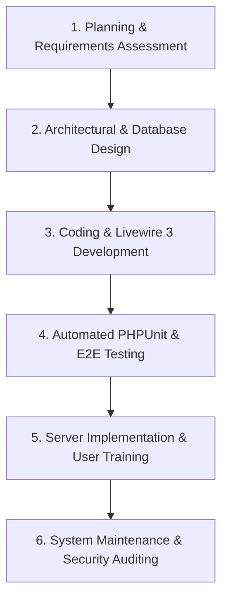
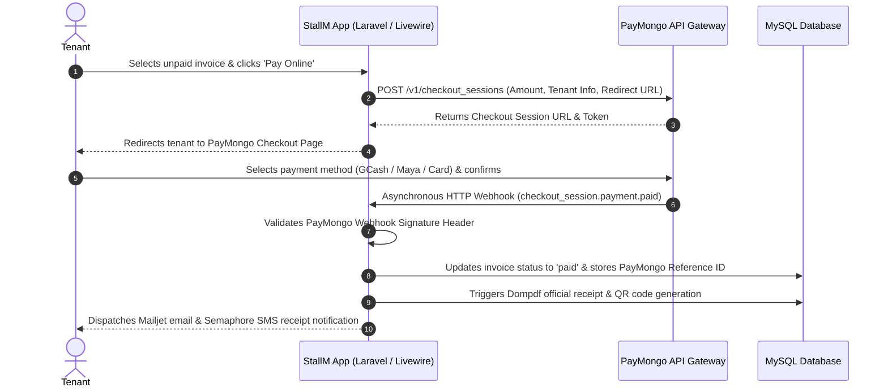
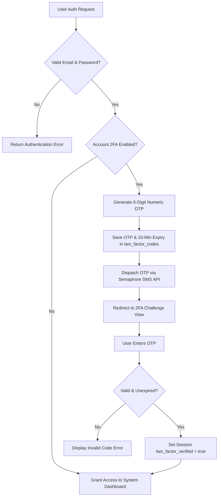

WEB BASED STALL MANAGEMENT SYSTEM FOR CENTER POINT

A Capstone Project Presented to the Faculty of
West Prime Horizon Institute, Inc.
Pagadian City, Zamboanga del Sur

In Partial Fulfillment
of the Requirements for Capstone Project II
For the Degree Bachelor of Science in Information Technology
Academic Year 2025–2026

By

DANISLYN G. BALBASTRO
WINLY JOHN B. ALEGADO
JOHN LLOYD B. RAMOS
MARIAM C. JAMIRO
ARJIE C. JUMUAD

July 2026

CHAPTER IV
DEVELOPMENT, TESTING, AND MAINTENANCE

This chapter details the development lifecycle, testing strategies, and deployment guidelines for the Web Based Stall Management System for Center Point. Developed to replace manual workflows at Center Point in Pagadian City, Zamboanga del Sur, the system automates tenant onboarding, stall lease contracts, monthly invoice generation, lease expiry notifications, online payments, utility billing, tenant document access, public stall reservation, advanced financial reporting, and administrative audit logging, all secured with social authentication and optional Two-Factor Authentication.

To build a reliable platform, the research team adopted the Software Development Life Cycle (SDLC) using the sequential Waterfall Model. The structured phases — Planning, Analysis and Design, Coding and Development, Testing, Implementation, and Maintenance — ensured that each technical and operational milestone was verified before proceeding to the next.

Planning

The planning phase began with an assessment of the administrative workflows at Center Point. Through interviews with the property manager and observation of daily operations, the researchers analyzed the challenges and inefficiencies of the existing manual administration system.

Historically, the administration tracked tenancies and payments using paper ledgers and physical folders stored in the office. The researchers identified several key operational bottlenecks:

Stall Allocation Overlaps: Tracking occupied, vacant, or maintenance-status stalls across multiple floor levels using paper logs was prone to booking conflicts and data inconsistencies, resulting in significant administrative overhead.

Invoicing and Computation Errors: Manually calculating monthly rent amounts and generating handwritten receipts resulted in arithmetic errors, delayed invoice delivery, and inconsistent billing records.

Delayed Payment Reconciliation: Tenants paid via physical cash, requiring manual verification of paper receipts. This delayed payment logging and created opportunities for financial discrepancies.

Unstructured Support Requests: Maintenance requests were submitted verbally or through informal messaging, leading to delays in resolution, a lack of documentation, and reduced accountability.

Lack of Tenant Transparency: Tenants had no self-service access to view their payment history, outstanding balances, lease details, or personal documents, creating frequent inquiries to office staff.

No Formal Reservation Channel: Prospective tenants had no formal online method for applying for a stall, requiring in-person visits for inquiries.

Absence of Lease Expiry Alerts: Administrators manually monitored lease end dates with no automated notification system, leading to risks of unmanaged contract expirations.

Insufficient Account Security: Administrative accounts had no layered authentication mechanism to protect sensitive financial and tenant data.

Lack of Financial Visibility: Management had no centralized financial reporting tool for analyzing revenue trends, occupancy rates, or overdue payment aging.

These findings confirmed the need for a centralized, automated digital platform to address all identified operational gaps.

Analysis and Design

Following the planning phase, the researchers defined the system modules, technical architecture, and relational database schema. The system was designed using Laravel 13.x with Livewire 3 for reactive, server-rendered user interface components.

The system architecture was organized into the following functional modules:

1. Authentication and Access Control: Secure user registration and login with Laravel Breeze scaffolding, Google OAuth 2.0 and Facebook OAuth social logins via laravel/socialite, CSRF protection, email and phone verification, and a CheckRole middleware enforcing role-based access for administrator, staff, and tenant roles. A public guest route serves the stall reservation portal without requiring authentication.

2. Two-Factor Authentication (2FA): An optional per-account security layer for administrator and staff users. When enabled, the system generates a 6-digit OTP, stores it with an expiry timestamp in the two_factor_codes table, and dispatches it to the user's registered phone number via Semaphore SMS. A dedicated RequiresTwoFactor middleware blocks access to privileged routes until the OTP is verified within the current session.

3. Stall Location Management: Organizing stall inventory by floor level or zone for structured navigation and floor plan organization.

4. Stall Administration: Managing stall records including stall identifier, monthly rental price, description, display image, grid position, and occupancy status (available, occupied, maintenance). An interactive Livewire-powered floor plan grid editor allows administrators to visually configure stall layouts per floor.

5. Stall Mapping and Lease Contracts: Linking tenants to stalls with specific contract start and end dates, active lease status tracking, PDF contract document uploads, and a lease renewal request workflow with administrator approval or rejection.

6. Lease Expiry Notification: A dedicated Artisan console command (stallm:notify-expiring-leases) registered in the Laravel scheduler to run daily. The command identifies leases expiring in exactly 60 days and 30 days and dispatches automated email notifications via Mailjet and SMS reminders via Semaphore to both the affected tenant and the administrator.

7. Automated Monthly Invoicing: Generating monthly rental invoices for all active tenant leases using a scheduled Laravel Artisan console command (stallm:generate-invoices). The command uses optimized Eloquent queries to avoid N+1 query problems and prevents duplicate invoice generation per billing period.

8. Payment Processing: Recording manually collected cash or office payments with custom reference IDs, and processing online payments via the PayMongo API using checkout sessions. An asynchronous webhook listener verifies the PayMongo signature and updates invoice statuses in real time upon payment confirmation.

9. Utility Billing: Recording metered utility readings (electricity, water) per tenant stall and computing associated charges for inclusion in billing statements.

10. Public Stall Reservation: A guest-accessible Livewire component displaying available stalls on a read-only floor plan grid. Prospective tenants can submit a formal rental application form including their name, contact details, business information, preferred stall, and an optional supporting document upload. Submissions are stored in the stall_applications table and trigger a confirmation email via Mailjet.

11. Stall Application Management: An administrative interface for reviewing, approving, or rejecting submitted stall applications. Approved applications can be linked to an existing or newly created tenant account for direct lease assignment.

12. Tenant Document Repository: A secure Livewire-powered section within the tenant portal where tenants can view and download all their documents, including lease contract PDFs, payment receipt PDFs, and billing statements. All file downloads are served through IDOR-protected file endpoints to prevent unauthorized access.

13. Advanced Financial Reporting and Analytics: An administrative reporting module providing interactive revenue trend charts (monthly and annual) and stall occupancy rate visualizations rendered using Chart.js. The module also provides an overdue payment aging report table and supports one-click export of financial summaries in CSV format and printable PDF reports via Dompdf.

14. Support Tickets and Real-Time Chat: An interactive helpdesk powered by Livewire 3 where tenants submit maintenance requests or inquiries. Features include real-time threaded messaging, typing indicators, file attachments, and read receipt tracking.

15. In-App Notification Center: A Livewire-powered notification bell delivering real-time in-app notifications for new invoices, payment confirmations, ticket replies, lease events, lease expiry warnings, and application status updates.

16. Audit Logging and Security Monitoring: Recording all significant administrative actions with the responsible user's identity, action description, affected entity, timestamp, and IP address.

The relational database schema is structured around the following core tables, managed through Laravel migrations:

- users: Stores credentials, roles (admin, staff, user), Google ID and Facebook ID for social logins, profile picture, email and phone verification timestamps, two_factor_enabled flag, and two_factor_confirmed_at timestamp.
- stall_locations: Categorizes stall zones or floor levels.
- stalls: Stores stall profiles, monthly rental rates, descriptions, display images, occupancy status, and grid layout positions per floor.
- stall_mappings: Tracks lease agreements linking a user to a stall. Stores contract start and end dates, active status, PDF contract document path, and renewal request status.
- payments: Tracks invoice records including billing amounts, payment method, PayMongo transaction ID, payment reference, payment notes, due date, paid timestamp, and payment status (pending, paid, failed).
- stall_applications: Stores online rental applications from the public reservation portal. Includes applicant name, email, phone, business name, business type, preferred stall ID, message, optional document path, application status (pending, approved, rejected), reviewed_by user ID, and reviewed_at timestamp.
- two_factor_codes: Stores active OTP codes for 2FA. Includes user ID, code, and expires_at timestamp. Codes are invalidated after use or expiry.
- tickets, ticket_messages, ticket_participants: Handles the support ticket system including message histories, file attachments, typing status, and read receipt tracking.
- utility_readings: Records metered utility readings per stall for billing computation.
- notifications: Stores in-app notifications per user with read/unread status.
- audit_logs: Logs administrative actions with user identity, action description, entity type and ID, timestamp, and IP address.
- settings: Stores global system configuration as key-value pairs.

Coding and Development

During the development phase, the researchers implemented the application using PHP 8.2+ and the Laravel 13.x framework. The development stack included:

IDE: Visual Studio Code with PHP Intelephense and Laravel extensions.

Local Server Environment: Laragon, providing a lightweight local stack with Apache, PHP 8.2, and MySQL for fast development and testing.

Dependency Management: Composer for managing the following key third-party libraries:

- laravel/livewire: Provides the reactive Livewire 3 component layer.
- laravel/socialite: Implements Google OAuth 2.0 and Facebook OAuth social authentication.
- dompdf/dompdf: Generates official PDF payment receipts and exportable financial report documents with embedded QR codes.
- mailjet/mailjet-apiv3-php: Sends transactional emails for billing reminders, payment confirmations, lease expiry notifications, application confirmations, and account events.

Frontend Design: Blade templating engine with Tailwind CSS for a modern, responsive, and clean user interface. Chart.js 4.x for interactive financial charts in the advanced reporting module.

Testing Framework: PHPUnit 11 with Laravel's built-in testing utilities for automated feature and unit testing.

Automated Monthly Invoice Generation

The system generates monthly rental invoices automatically through a dedicated Laravel Artisan console command registered in the application scheduler. The command (stallm:generate-invoices) retrieves all active stall mappings with their associated stall pricing and tenant information using a single optimized Eloquent query. For each active mapping, it checks whether an invoice already exists for the current calendar month. If none exists, a new invoice record is created with the billing amount, due date set to the last day of the current month, and a pending payment status.

The Laravel Artisan scheduler is configured to run this command monthly and to dispatch multi-stage payment reminder notifications — via Mailjet email and Semaphore SMS — at seven days before the due date, three days before the due date, and on the due date itself.

Lease Expiry Automated Notification System

The system dispatches automated lease expiry notifications through a separate scheduled Artisan command (stallm:notify-expiring-leases), registered to run daily. The command queries the stall_mappings table for active leases whose end_date falls exactly 60 days and 30 days from the current date. For each matching lease, the system dispatches a notification to both the tenant and the administrator via Mailjet email and Semaphore SMS, informing them of the approaching contract expiration and prompting the tenant to submit a renewal request if needed. This eliminates the risk of unmanaged lease expirations and reduces administrative oversight requirements.

PayMongo Online Payment Gateway Integration

To support online rental payments via GCash, Maya, and credit or debit cards, the system integrates with the PayMongo REST API. The following sequence diagram details the interaction flow between the tenant, the StallM system backend, the PayMongo API, and the database upon payment completion:

1. Session Creation: When a tenant selects unpaid invoices and clicks "Pay Online," the payment controller sends a request to the PayMongo API to create a Checkout Session populated with billing details, tenant information, and redirect URLs.

2. Tenant Redirection: PayMongo returns a unique checkout URL. The system redirects the tenant to this hosted payment page to complete the transaction.

3. Asynchronous Webhook Verification: Upon successful payment, PayMongo dispatches an HTTP POST webhook event. The system validates the PayMongo signature header, parses the event payload, locates the corresponding invoice records, and updates their status to "paid" with the payment method, PayMongo transaction ID, and paid timestamp.

4. PDF Receipt Generation: Following payment confirmation, the system automatically generates an official A4 PDF receipt using Dompdf featuring an embedded SVG QR code linking to the online receipt verification endpoint.

Advanced Financial Reporting and Analytics

The advanced reporting module provides administrators with a comprehensive financial overview of Center Point operations. The module renders interactive revenue trend charts using Chart.js, displaying monthly and annual rental income. Stall occupancy rate charts provide a visual breakdown of available, occupied, and maintenance-status stalls. An overdue payment aging report table lists all tenants with overdue invoices grouped by the number of days past due. Administrators can export revenue and payment data to CSV using Laravel's streaming response, and generate a printable PDF financial summary report via Dompdf.

Two-Factor Authentication (2FA)

The system implements optional Two-Factor Authentication for administrator and staff accounts. When an administrator or staff member enables 2FA through their account settings, all subsequent logins trigger a secondary verification step. The security verification sequence is illustrated in the flowchart below:

After successful password authentication, the system generates a cryptographically random 6-digit OTP, stores it in the two_factor_codes table with an expiry timestamp of 10 minutes, and dispatches it to the user's registered phone number via Semaphore SMS. The user is then redirected to a challenge page where they must enter the OTP to complete the login. A dedicated RequiresTwoFactor middleware, applied to all administrator and staff route groups, verifies the presence of a valid two_factor_verified flag in the session and redirects unverified users to the challenge page. OTP codes are invalidated immediately upon successful verification or upon expiry.

Public Stall Reservation Portal

The public-facing stall reservation module is accessible to unauthenticated users. The module displays the available stalls on a read-only floor plan grid. Prospective tenants can select a preferred stall and complete an online application form providing their name, contact details, business name, business type, and an optional supporting document. Upon submission, a record is created in the stall_applications table, a confirmation email is dispatched to the applicant via Mailjet, and an in-app notification is sent to the administrator. Administrators and staff can then review, approve, or reject applications through the Stall Application Management interface.

Tenant Document Repository

The tenant document repository provides tenants with a centralized, secure section within their portal to access all their personal documents. The repository lists lease contract PDFs (sourced from stall_mappings.contract_document), payment receipt PDFs (generated on demand via Dompdf), and billing statements. All documents are served through IDOR-protected file endpoints in the FileController, which verify that the requesting user is the authorized owner of the requested document before serving the file. This prevents unauthorized access to other tenants' sensitive documents.

Support Ticket and Real-Time Chat System

The support ticket module enables structured communication between tenants and administrative staff. Tenants submit support tickets through the dedicated Livewire component, providing a subject and initial message. The system automatically creates participant records for both the submitting tenant and the assigned staff member. The Livewire-powered chat interface supports threaded messaging with the last-read timestamp tracked per participant, file attachment uploads served through IDOR-protected endpoints, and real-time typing status indicators.

Audit Trail Logging

The system records all significant administrative actions in the audit_logs table including updates to stall pricing or status, lease contract creation or termination, manual payment recording, payment status adjustments, stall application reviews, 2FA configuration changes, and support ticket resolutions. Each log entry captures the responsible user's identity, the action performed, the affected entity type and record ID, the timestamp, and the user's IP address.

Testing

Testing was conducted in two structured stages: Automated Component Testing using PHPUnit 11 and End-to-End System Testing simulating complete user workflows.

Component Testing

Each system module was verified against its functional requirements using PHPUnit 11 automated test cases. The following areas were covered:

- Authentication: Verified standard login, Google OAuth login, and Facebook OAuth login flows, and confirmed that role-based redirects function correctly for admin, staff, and tenant accounts.
- Two-Factor Authentication: Verified OTP generation, Semaphore SMS dispatching, OTP verification, OTP expiry enforcement, and that the RequiresTwoFactor middleware correctly blocks access when 2FA is enabled and not yet verified in the session.
- Lease Mapping: Verified that stall mappings are correctly created, that stall status is updated accordingly, and that lease renewal workflows function correctly.
- Lease Expiry Notifications: Verified that the stallm:notify-expiring-leases command identifies the correct leases at 60 and 30 days before expiration and dispatches email and SMS notifications to both the tenant and administrator.
- Invoice Generation: Confirmed that the invoice generation command produces exactly one invoice per active mapping per billing month without duplication.
- PayMongo Webhook: Verified that the webhook endpoint correctly validates PayMongo signatures and accurately updates invoice payment status.
- Stall Reservation: Confirmed that the public reservation form creates a stall_applications record, dispatches a confirmation email, and sends an admin in-app notification.
- Document Repository: Verified that tenants can access only their own documents through the IDOR-protected endpoints, and that unauthorized access attempts are correctly rejected.
- Advanced Reports: Verified that revenue aggregation queries return correct totals and that CSV and PDF exports are generated without errors.
- Support Ticket System: Confirmed that ticket creation, message threading, and participant mapping function correctly for both tenant and staff users.

System Testing

Once component testing was complete, the researchers conducted end-to-end integration testing following a complete tenant lifecycle:

Reservation Portal Submission → Admin Application Review & Approval → Tenant Account Creation → Google or Facebook OAuth Login → Admin 2FA Setup and Verification → Stall Assignment → Stall Lease Mapping with PDF Contract → Monthly Invoice Generation → Lease Expiry Notification (at 60 and 30 days) → PayMongo Online Checkout → Webhook Status Verification → PDF Receipt Download → Document Repository Access → Support Ticket Submission → Admin Chat Response → Lease Renewal Request → Advanced Reports Generation and Export → Lease Termination

Database Transaction Verification: The database was monitored to ensure that stall status updates, payment record creation, lease status changes, notification dispatching, and stall application status updates were all triggered correctly without data anomalies.

Security Assessment: Access control was rigorously verified by attempting to access administrative URLs using tenant-role accounts, by attempting to download another tenant's documents through direct URL manipulation, and by attempting to bypass 2FA challenge routes using session manipulation. All unauthorized access attempts were correctly blocked.

Browser Compatibility: The user interface, reservation portal, and advanced reporting charts were tested on Google Chrome and Microsoft Edge, confirming responsive layout and correct Chart.js rendering across screen sizes.

Payment Gateway Testing: PayMongo checkout flows were tested using the PayMongo sandbox environment, verifying correct session creation, payment redirection, webhook delivery, signature verification, and invoice status updating.

Implementation

The system was deployed using the following installation procedure.

Installation Checklist

1. Server Environment Setup: Install PHP 8.2+, Apache or Nginx, and MySQL on the server machine.

2. Application Deployment: Clone the application source code repository to the target server directory.

3. Environment Configuration: Copy the .env.example file to .env and configure the following environment variables:
   - Database connection credentials (DB_HOST, DB_DATABASE, DB_USERNAME, DB_PASSWORD)
   - Application key (generated via artisan key:generate)
   - PayMongo API keys (PAYMONGO_PUBLIC_KEY, PAYMONGO_SECRET_KEY, PAYMONGO_WEBHOOK_SECRET)
   - Mailjet API credentials (MAILJET_APIKEY, MAILJET_APISECRET)
   - Semaphore SMS API key (SEMAPHORE_API_KEY)
   - Google OAuth credentials (GOOGLE_CLIENT_ID, GOOGLE_CLIENT_SECRET)
   - Facebook OAuth credentials (FACEBOOK_CLIENT_ID, FACEBOOK_CLIENT_SECRET, FACEBOOK_REDIRECT_URI)
   - Application URL (APP_URL)

4. PHP Dependencies: Run Composer to install all required PHP packages:

      composer install --optimize-autoloader --no-dev

5. Application Key Generation:

      php artisan key:generate

6. Database Migration: Execute all Laravel migrations to create the required database schema including stall_applications and two_factor_codes tables:

      php artisan migrate

7. Database Seeding: Run the database seeder to generate default administrator, staff, and tenant accounts:

      php artisan db:seed

8. Storage Link: Create the symbolic link from the public storage directory:

      php artisan storage:link

9. Cron Scheduler Configuration: Configure a server cron job to execute the Laravel Scheduler every minute, enabling automated invoice generation, payment reminder dispatching, and daily lease expiry notification dispatching:

      * * * * * cd /path/to/stallm && php artisan schedule:run >> /dev/null 2>&1

User Handover and Training

The researchers conducted a user training and handover session for the administrators and staff of Center Point covering:

- Stall management: Assigning floor locations and configuring the floor plan grid editor.
- Tenant onboarding: Creating tenant accounts, assigning stalls, and uploading PDF lease contracts.
- Stall application management: Reviewing, approving, and rejecting online rental applications submitted through the public reservation portal.
- Payment management: Recording manual payments and reviewing PayMongo online payment records.
- Viewing and downloading PDF receipts and verifying payments through the QR code endpoint.
- Accessing the tenant document repository as an administrator to verify document availability.
- Advanced financial reporting: Generating revenue trend charts, occupancy reports, aging reports, and exporting financial summaries in CSV and PDF formats.
- Managing support tickets: Responding to tenant concerns through the threaded chat interface.
- Utility billing: Recording utility meter readings and generating utility billing charges.
- Two-Factor Authentication setup: Enabling 2FA on administrator and staff accounts and configuring registered phone numbers.
- Reviewing audit logs: Monitoring the administrative audit trail for accountability.
- Security best practices: Password policies, API key rotation, and regular database backups.

Maintenance

To ensure the long-term reliability, security, and performance of the system, the researchers recommend the following maintenance guidelines:

Database Backups: The MySQL database should be backed up at minimum weekly using automated backup tools to prevent data loss.

Software and Dependency Updates: The PHP environment, Laravel framework, and Composer-managed packages (including Dompdf, laravel/socialite, Chart.js, and the Mailjet SDK) should be periodically reviewed and updated to address security vulnerabilities.

API Key Rotation: PayMongo, Mailjet, Semaphore, Google OAuth, and Facebook OAuth credentials should be rotated annually or immediately if suspected to be compromised.

Log Management: Administrators should review system error logs (storage/logs/laravel.log) and audit log records monthly to identify anomalies or unauthorized access attempts.

Scheduler Monitoring: The Laravel Artisan scheduler — responsible for monthly invoice generation, payment reminders, and daily lease expiry notifications — should be periodically verified to confirm correct cron execution on the server.

Storage Management: The private file storage directory (used for lease contract PDFs, ticket attachments, and reservation application documents) should be monitored for disk space usage and cleaned up as needed.

Two-Factor Authentication Review: Administrators should periodically review which accounts have 2FA enabled and ensure that all active administrator and staff accounts have registered and verified phone numbers to support the SMS OTP delivery.
