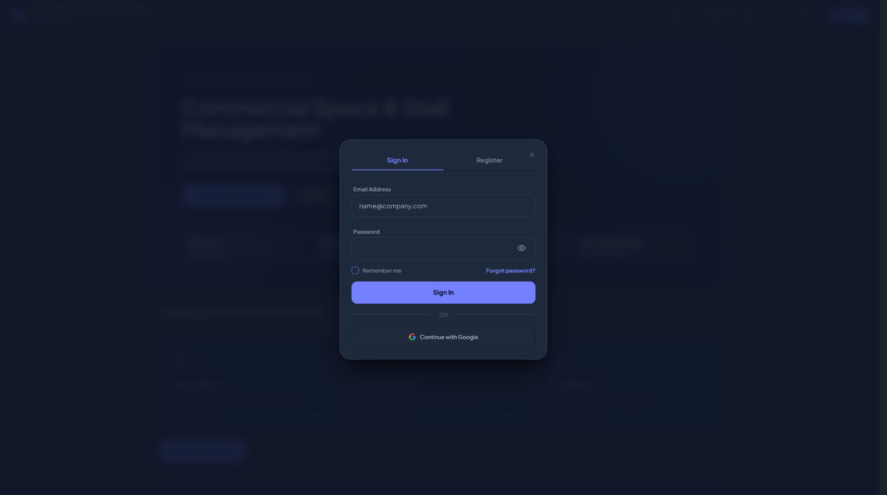

# Authentication follow-up

Corrected the previous modal sizing regression: a late global max-width declaration replaced the auth dialog's max-w-md limit. The viewport constraint now sets width and preserves each dialog's existing maximum width.

Added independently controlled eye buttons to login password, registration password and confirmation. They start concealed, use native buttons, announce Show/Hide and pressed state, and do not submit forms. Existing style retained; ENERGY 1 / RHYTHM 1 / MOTION 1.

- Hard Gate PASS (change scope): login width 448px at 1920px; registration width 280px at 320px, password fields and icon buttons 44px tall. Click Show produces type=text; keyboard Enter on Hide restores type=password. Both registration toggles work independently. Escape closes dialog. No sampled console errors.
- Purpose Gate PASS: compact form width improves reading; eye icons expose the requested password visibility action. No decorative additions.
- Liveliness PASS (preservation): existing commercial portal typography, accent, dialog elevation and content hierarchy retained.
- Craftsmanship PASS: shared input component with opt-in toggles; Vite build succeeds; 10 relevant tests pass with 77 assertions; git diff --check passes.

The screenshot confirms desktop geometry. Physical device keyboard behavior was not tested.

Second follow-up: added an explicit width/max-width directly on the authentication box so it remains capped even if an already-open page retains the earlier global stylesheet. Moved eye buttons 8px inward and increased input padding to match. Rebuilt assets and cleared compiled Blade views. Fresh-page runtime loads app-DBR5J9gJ.css, measures 448px at 1920px and 280px at 320px, and measures an 8px inset from the input edge to the button edge. Show/Hide and Escape still work. The same scoped gate passes for these sizing and alignment changes.

