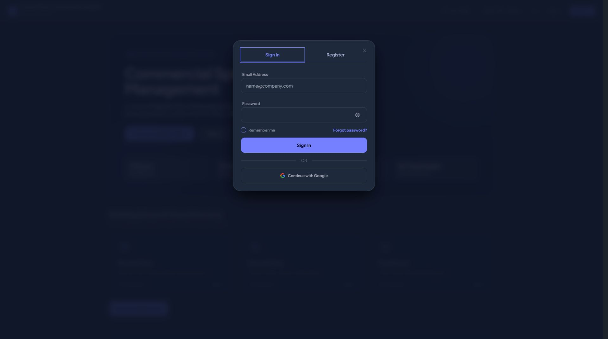
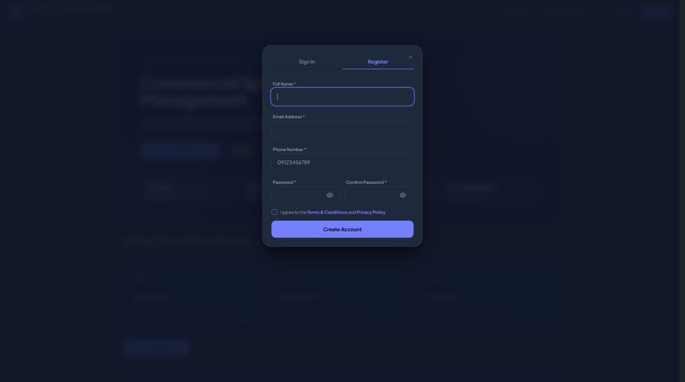

# Sign In / Register transition repair

Direct browser recheck reproduced the reported jump: at 1920x1080, login was y=302px/high=476px; register was y=258px/high=564px. Tab clicks previously made server requests and replaced the form.

Both forms now remain mounted. Alpine switches visibility immediately, with deferred Livewire state synchronization on the next real request. Each form keeps its values and independent password toggle state. Server validation, login, registration and recovery remain Livewire actions. The dialog uses a stable top anchor instead of recentering when content height changes; height remains bounded and scrollable on small screens. Hidden panels stay outside keyboard traversal. The accessible dialog name and button pressed states update locally.

## Scoped gate and evidence

- Hard Gate PASS: four repeated desktop switches each measured y=128px, width=448px, with focus on the selected button. Four mobile switches at 320x568 each measured y=68.15px, width=280px, height=479.84px. No sampled console errors. Keyboard Enter switches the panel. A typed registration name survives switching away and back. Forgot Password and Back to Sign In work. Login submission after all those switches succeeds and shows the tenant dashboard.
- Purpose Gate PASS: local switches remove server wait; stable top alignment keeps the tabs from moving. No added decorative motion.
- Liveliness PASS for preservation: original portal typography, colors and dialog styling retained (ENERGY 1 / RHYTHM 1 / MOTION 1).
- Craftsmanship PASS: production build succeeds; 28 relevant tests pass with 166 assertions; git diff --check passes. The final asset is app-Chx_3-IP.css.

Opening auth and submitting/recovering credentials still require server requests. Switching Sign In / Register within an open dialog does not. Registration was not submitted and no recovery code was requested during the browser check.

