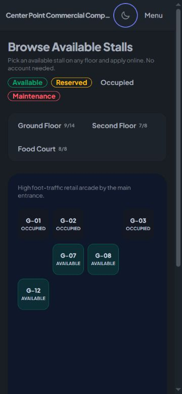

# Anti-slop follow-up: audit 001

Date: 2026-10-08. Mode: After (user session choice). Authorization: user requested "fix all issues" after the eleven findings in audit-001-2026-10-08.md.

All eleven reported findings have been addressed in source. The scope is those findings, not a certification of every screen, contrast pairing, or business workflow in the application.

| Finding | Resolution | Evidence |
| --- | --- | --- |
| 1. Header overflow | Flexible truncated brand, mobile public menu, wrapping footer links | Home checked at 320, 375, 640, 768, 1024, 1280, 1440px. All 15 admin pages at 375px and all five tenant pages at 320px have equal document scroll/client widths. |
| 2. Support chat clips | Shared viewport-constrained width/height and visual viewport keyboard offset | Admin demo chat at 320x568: width 288, top 32, bottom 552, right 288.8. At 667x375: height 343.2, top 16, bottom 359.2. Tenant uses the same class. |
| 3. Keyboard navigation controls | Native sidebar, account and notification buttons; accessible theme checkbox | Enter opens sidebar, aria-expanded becomes true; Enter on Close menu returns focus to trigger with aria-expanded false. Theme checkbox is in the Tab order and has a visible wrapper focus outline. |
| 4. Invalid focus color | OKLCH color syntax matching DaisyUI 4 tokens | Runtime outline changed from none to solid for dialog and grid controls. |
| 5. Dialog semantics and ghost controls | Native dialogs opened with showModal, shared focus trap/return, navigation observer reconnect, closed dialogs display:none | Auth and stall dialogs report open=true; Shift+Tab wraps within auth; Terms Escape closes only child and returns focus to parent Terms control; parent Escape closes it. Stall Apply survives Livewire morphing. Profile dialog opens natively with focus on Close. |
| 6. Form associations | Shared labelled input component and explicit errors/aria-invalid/describedby; profile upload exposed | Browser resolves login fields by label. Profile name, phone, email and upload have associated labels. Auth, profile, application and status errors reference their inputs. Terms checkbox errors also associated. |
| 7. Mouse-only map cells | Separate native primary cell button and always-visible removal button | All 48 cells have row/column names; Enter on an empty cell without a selected stall invokes the control without changing data. Removal opacity 1, height 44px on mobile. Existing placement/move/bounds tests pass. |
| 8. Faint stall/coordinate text | Theme-specific solid readable text tokens | Dark #cbd5e1 against #0f172a: 12.02:1. Light #334155 against white: 10.35:1. Public occupied labels no longer use reduced opacity. Exact translucent composites may differ, but these representative backgrounds exceed AA. |
| 9. Small mobile controls | 44px minimum control size, 16px form text, single-column modal forms | Login/profile inputs and editor removal controls measured 44px below 768px. Public floor buttons wrap without document overflow. |
| 10. Incomplete tabs | Floor selector is an ordinary button group with aria-pressed and aria-controls | Runtime accessibility tree exposes Ground Floor pressed and the other two buttons unpressed. |
| 11. False policy dates | Removed dynamically generated Last updated date | Both public policy templates no longer assert a fabricated revision date. |

## Verification

- Full Laravel suite: **342 passed, 1272 assertions**, 52.53 seconds.
- Follow-up after terms-error markup adjustment: **23 passed, 46 assertions** (LoadingStates, ProfileModal, TermsWording).
- Production Vite build succeeds; tracked manifest and generated assets updated (app-BHWzGhIb.css and app-B-iluf1x.js).
- Final theme keyboard retest: Space on the checkbox selects light, focus remains on theme-toggle, wrapper outline is solid, and document width remains 360px at a 375px viewport. Space restores dark. No browser console errors were recorded in the sampled session.
- `git diff --check` passes.
- Admin pages checked: dashboard, stalls, floors, grid-editor, mappings, tenants, applications, payments, calendar, reports, tickets, announcements, audit-logs, error-logs, settings.
- Tenant pages checked: dashboard, leases, payments, documents, tickets. At 320px each had clientWidth=scrollWidth=305px (scrollbar consumes the remaining viewport width).
- Click-through: public Menu opens links; Sign In opens native auth dialog; Register changes fields; Terms opens child dialog; Escape closes child then parent; stall opens details; Apply opens form; sidebar opens/closes with Enter; grid cell responds to Enter; admin closed-ticket Manage opens chat; Close dismisses chat; Profile Settings opens profile; Escape dismisses profile; local demo login/logout completed.
- Opening the closed local demo support ticket marked its existing message read. No chat messages, payments, applications, profile updates or map placements were submitted through the browser.

## Scoped delivery gate

- **Hard Gate PASS for the eleven remediation items:** recorded layout, keyboard, focus, native-dialog and labelled-input checks above; policy dates removed; build and suite pass. A click-through of every unrelated business action and contrast check of every existing color are outside this remediation scope.
- **Purpose Gate PASS for changes:** mobile menu makes existing routes fit; readable colors serve legibility; native buttons provide keyboard operation; shared modal and chat behavior prevents clipping and focus loss. No decorative assets were introduced.
- **Liveliness PASS for preservation scope:** existing commercial portal identity, floor plan motif, primary accent and content hierarchy retained. Conservative inherited dials: ENERGY 1 / RHYTHM 1 / MOTION 1. This work repairs the existing interface and does not propose a new visual direction.
- **Craftsmanship PASS for changes:** one shared dialog helper, one shared form field component and one shared chat class; actual production assets built; application routes remain Blade layout wrappers as required by project instructions.

Limitations: browser viewport emulation does not prove behavior on a physical iOS/Android keyboard. VisualViewport handling is implemented, but physical-device keyboard and screen-reader testing remain recommended. No production deployment was requested or performed.

