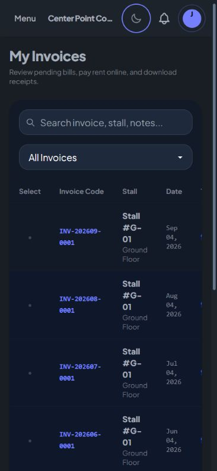

# Global scrollbar update

Replaced the older global scrollbar and consolidated the modal thumb styling into one global rule set. Pages, sidebars, dropdowns, tables, chat panels, inputs and modals now share a rounded slate thumb with a transparent track. A 10px gutter contains a 4px visible thumb (transparent 3px borders), and arrow buttons are removed. Light/dark tokens match the existing UI. Modals retain their extra 20px track clearance near rounded corners. Firefox uses thin native scrollbars; Chromium/WebKit use custom pseudo-elements and reset DaisyUI's conflicting scrollbar-color.

- Hard Gate PASS for change scope: at a 375px viewport, document clientWidth=scrollWidth=366px; root scrollbar computed width=10px, transparent thumb borders, native color=auto, arrow display=none. Tenant invoice table client width 332px, scroll width 596px, horizontal scrollbar height 10px and color=auto. Light mode selects #94a3b8 thumb; dark mode was restored after checking.
- Purpose Gate PASS: one style improves consistency and reduces visual weight while keeping scrolling available. Modal corner clearance retained.
- Liveliness PASS for preservation: existing slate surfaces and UI identity retained; ENERGY 1 / RHYTHM 1 / MOTION 1.
- Craftsmanship PASS: shared styles replace duplicated modal rules; production build and git diff --check pass. Latest CSS app-CoRMilwg.css. No behavior changes or tests added for this reversible CSS change.

Native mobile overlay scrollbar appearance remains browser-controlled on some devices; Firefox fallback was implemented but not directly tested.

