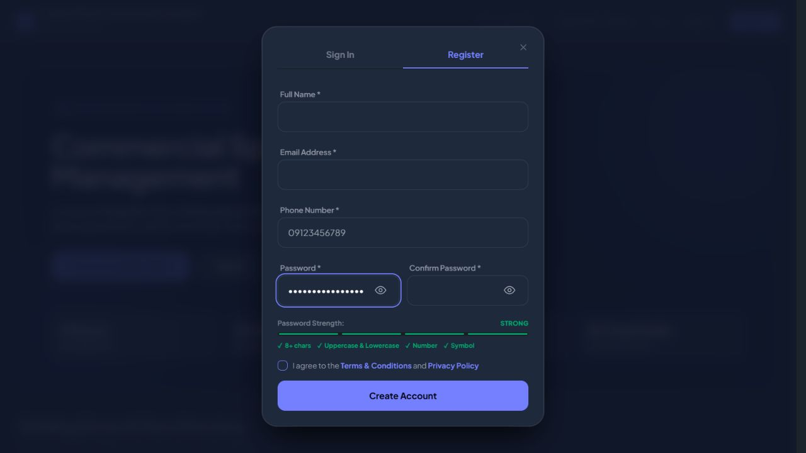

# Interaction recheck

Scope: public auth flows, navigation across all fifteen admin and five tenant pages, representative search/pagination and modal transitions. User reported actions across all pages feel discontinuous. Changes retain the existing portal style (ENERGY 1 / RHYTHM 1 / MOTION 1).

## Reproduced causes and corrections

1. Registration password typing caused a Livewire update to remove the native dialog open attribute. Reopening the dialog automatically focused Close. The shared modal helper now remembers and restores the last focused control when reopening an existing modal. Before: focus=Close after typing. After: focus=field-regPassword after two password updates, including revealed-password typing.
2. Every input focus called scrollIntoView on every device. This can move the page unexpectedly even with no onscreen keyboard. It now runs only when the visual viewport is substantially reduced by a keyboard, and only for an input outside that visible area.
3. The layout registered new document progress-bar listeners on every Livewire navigation. They accumulated while holding detached old progress-bar elements and timers. Progress handling now lives in a single bundled JS module, resolves the current bar on every event, and cancels obsolete timers.
4. Authentication submit buttons disabled on every component request, including password-strength updates. Loading targets now match the actual submit actions. Registration's submit button remains enabled after password updates.
5. Offscreen mobile sidebar links stayed available to keyboard focus. The closed mobile sidebar is now inert; opening it restores access, and navigating to Stalls closes it again (aria-expanded=false and inert present).
6. Shared form fields now have stable Livewire keys, keeping Alpine password visibility state tied to the intended field rather than a different field after switching forms.

## Browser evidence

- Register opens. Password live update keeps focus in field-regPassword. Show password -> type=text; another update keeps focus and visibility. Sign In switches fields and login succeeds with the local demo account.
- Admin sidebar navigation: dashboard, stalls, floors, grid-editor, mappings, tenants, applications, payments, calendar, reports, tickets, announcements, audit-logs, error-logs, settings. Each clicked route shows its expected heading and no stale open dialogs.
- Payments search for a nonexistent term shows No payment records found and keeps typing focus. Clearing restores results. Page 2 shows results 11 to 20 of 26.
- Mobile sidebar opens with Enter. Stalls navigation closes it and makes it inert. Manage opens stall details; Edit Stall transitions to the editor; Escape closes it and returns focus to Manage. No stall edits submitted.
- Tenant navigation: dashboard, leases, payments, documents, tickets; expected headings appear after each sidebar click.
- Tenant logout returns home; fresh Register opens; another live password update keeps focus and leaves submit enabled. The final sampled browser console has no errors.

One admin test tab encountered an unexpected browser confirmation and stalled during subsequent inspection; it was dismissed, and verification continued in a fresh tab. A fresh tenant login/navigation/logout sequence completed. This recheck does not prove every possible business action or that all latency is eliminated. Server-backed actions still wait for an HTTP response; no backend performance benchmark was taken.

## Validation and scoped delivery gate

- **Hard Gate PASS for fixes:** browser evidence above; native modal focus maintained, sidebar keyboard access intentional, and no sampled console errors. Full Laravel suite: **342 tests, 1272 assertions passed**. Targeted run: **33 tests, 120 assertions passed**. Production build and git diff --check pass.
- **Purpose Gate PASS:** changes reduce lost focus, unsolicited scrolling, duplicate lifecycle work and misleading disabled states. No decorative techniques or assets added.
- **Liveliness PASS for preservation:** existing commercial portal identity, typography, accent and floor-map hierarchy retained.
- **Craftsmanship PASS:** shared JS helpers and form component apply the fixes across pages; financial, account and destructive actions were not submitted to verify UI transitions.

New production assets: app-ESnehFju.css, app-C7uaI4Am.js. Already-open pages should be fully reloaded to load the updated scripts.

