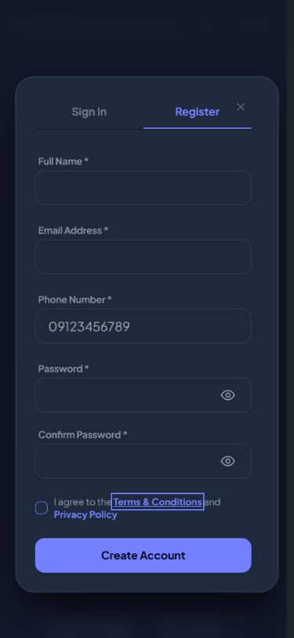

# Modal opening and closing follow-up

Auth previously waited for a Livewire round trip to mount and remove the dialog. Sign-in and registration now stay mounted, open locally, and close locally. Their panels keep the existing fixed top anchor. Dismissal clears password values and resets password visibility.

The shared modal manager adds a subtle 140ms entrance and 120ms exit with a 6px movement. Auth remains in the native dialog top layer until its exit finishes. Removed server-rendered dialogs use a temporary, inert presentation that is removed after the exit. Reduced-motion preferences skip these animations. Stable root scrollbar space prevents horizontal movement when scrolling locks.

- Hard Gate PASS for this scope: checked desktop repeated auth opening/closing and mobile Escape, backdrop dismissal, and nested Terms dismissal. Focus returns to the opener; closing Terms leaves registration open. Mobile password values clear and return to masked fields. Stall-details closing leaves zero open dialogs and zero exit copies, restores focus to G-06, and unlocks page scrolling.
- Purpose Gate PASS: local auth controls remove unnecessary network waiting; shared movement gives modal opening/closing consistent feedback. Data-backed dialogs continue to fetch content and run close checks through Livewire.
- Liveliness PASS for preservation: existing surfaces and colors retained; ENERGY 1 / RHYTHM 1 / MOTION 1.
- Craftsmanship PASS: production build succeeds; full suite passes with 342 tests and 1269 assertions. Browser sign-in reaches the demo tenant dashboard. No browser errors were captured during the stall-details check. Final JS asset is app-C4HaVcFC.js. git diff --check passes.

Verification covered representative shared modal behavior, not every server-driven workflow. Reduced-motion support was reviewed in source, not emulated. Browser automation became unavailable during final demo logout navigation; the saved mobile screenshot comes from the earlier successful lifecycle check.

