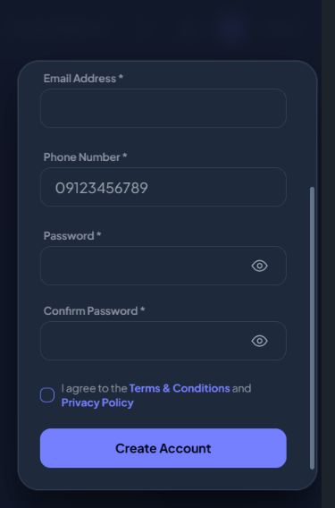

# Modal scrollbar review

Reviewed modal-box and nested overflow declarations across all 14 Livewire view files that contain modal boxes. Shared styling now reserves a stable gutter, uses a narrow rounded thumb on a transparent track, and insets the track 20px from the panel's top/bottom rounded corners. Chromium/WebKit thumbs have transparent borders to inset the visible thumb laterally; Firefox uses its thin native scrollbar with theme-aware color. Native arrow buttons are removed where custom scrollbar selectors are available.

DaisyUI's inherited scrollbar-color was overriding the WebKit custom appearance in Chromium. The new modal-only override resets that property in WebKit-supporting browsers so custom track margins and thumb borders actually render. Page scrollbars remain unchanged.

Terms and Privacy use a flex column with only the text body scrolling. Their titles and actions remain outside that scrolling region, avoiding two independently scrolling vertical containers.

## Scoped gate

- Hard Gate PASS: registration tested at 375x568 with scrollHeight 654px, clientHeight 478px, stable gutter and 20px track margins; keyboard navigation scrolls Create Account into view. Terms at 375x568 has outer clientHeight=scrollHeight=480px, inner text 318px/426px, footer inside box. Privacy at 667x375 has outer clientHeight=scrollHeight=318px, inner text 156px/289px, footer bottom 322.4px inside box bottom 347.2px. Light-mode profile also receives the shared track style and scrolls within its 318px panel. Escape closes tested dialogs. Source review covers all modal boxes; every individual business dialog was not opened at runtime.
- Purpose Gate PASS: gutter separates content from scrollbar; corner clearance protects rounded silhouette; subdued thumb colors match existing slate panels. No scrollbar is hidden to prevent navigation.
- Liveliness PASS for preservation: existing UI identity and conservative dials retained (ENERGY 1 / RHYTHM 1 / MOTION 1).
- Craftsmanship PASS: one shared modal scrollbar style applies to modal boxes and nested scroll containers. Build succeeds; 7 relevant tests pass with 59 assertions; git diff --check passes. Latest CSS: app-DO93HwPy.css.

Firefox and physical-device overlay scrollbar rendering were not tested directly. The explicit native fallback is implemented. Terms acceptance and form submissions were not used during testing.

