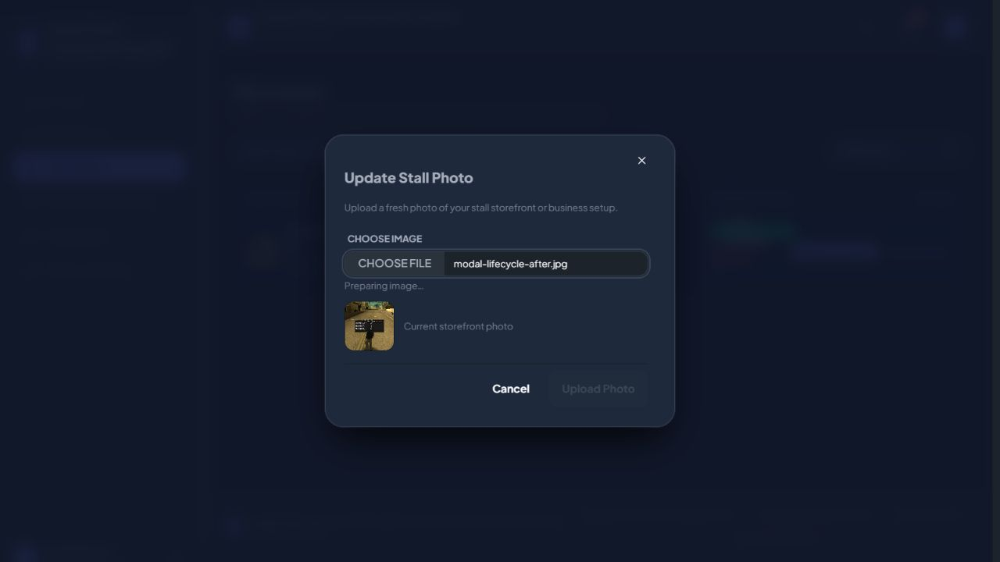

# Photo upload validation follow-up

The selected image could finish temporary uploading after an early submit had produced a required-field error. The error remained while the preview unconditionally advertised readiness. Selection now validates image type and the 5MB limit, clearing obsolete errors. Invalid files are not previewed as ready. The submit button is disabled without a valid selection, during temporary uploading, and during saving. Preparing/saving feedback explains each stage.

- Hard Gate PASS for scope: browser verified Upload Photo disabled on an empty selection and enabled after a test image was prepared. Cancel discarded the selection without changing the storefront. Regression tests verify that selecting a valid image clears the earlier required error and that a non-image is not advertised as ready.
- Purpose Gate PASS: readiness and errors now reflect the same validation state; premature submission is blocked.
- Liveliness PASS for preservation: existing modal appearance retained; ENERGY 1 / RHYTHM 1 / MOTION 1.
- Craftsmanship PASS: LeaseRenewalUiTest passes 10 tests / 29 assertions; git diff --check passes. No bundled assets changed by this Blade/PHP fix.

