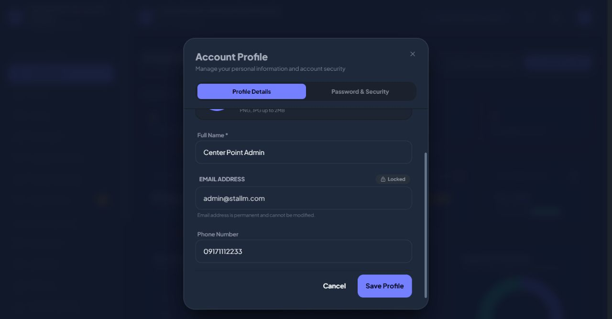
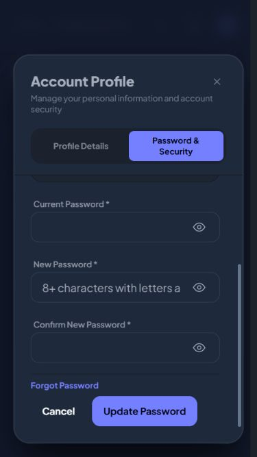

# Profile scrolling follow-up

Reproduced the whole modal scrolling at 1280x667: title y moved from 124.86px to 24.06px while the outer box scrolled 100.8px. The close button moved toward the rounded edge with it.

Split the profile into a fixed header and one inner scroll area. The title, tabs, and close button remain stationary. Removed the header spacing rule that also applied after its absolutely positioned close button. The form body retains stable scrollbar space, contains overscroll, and resets to the top on tab selection.

- Hard Gate PASS for scope: after desktop wheel scrolling, header y remains 104.86px, inner body scrollTop=93.6px, and outer box scrollTop=0. At 375x667, header y remains 104.86px while the Security body scrolls 173.6px; body clientWidth=scrollWidth=324px. Switching tabs resets scrollTop=0. Close remains usable; viewport reset after checks.
- Purpose Gate PASS: fixed controls stay accessible while long form contents scroll.
- Liveliness PASS for preservation: existing theme retained; ENERGY 1 / RHYTHM 1 / MOTION 1.
- Craftsmanship PASS: production build, git diff --check, and 6 profile tests with 19 assertions pass. Actual wheel input verified both desktop and mobile scrolling.

