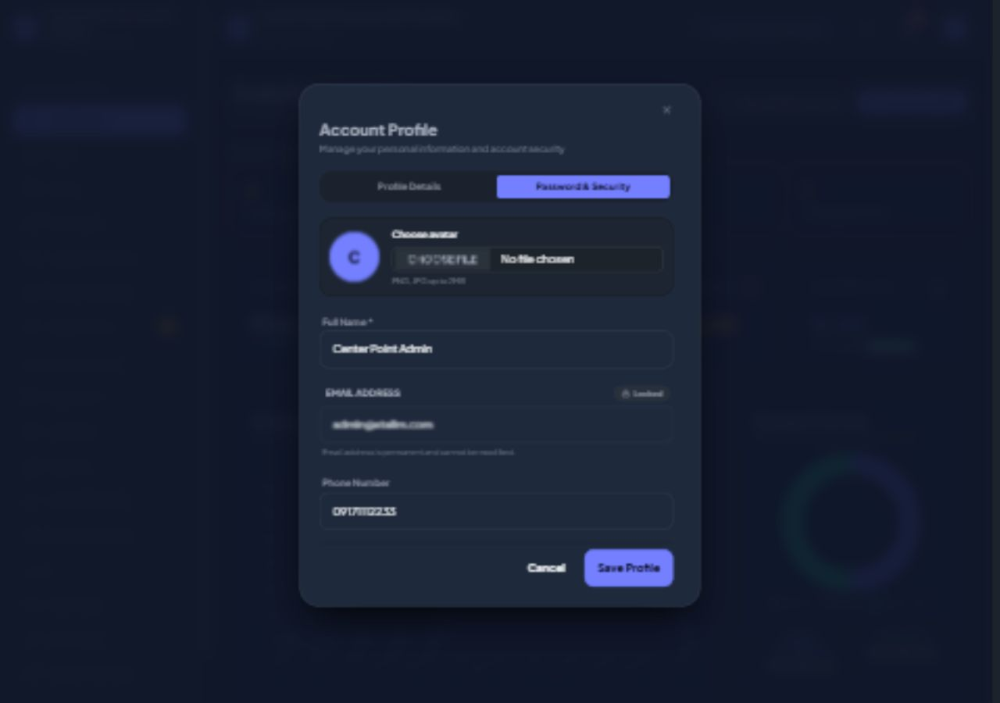
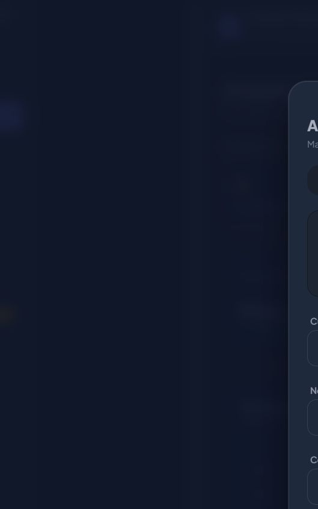
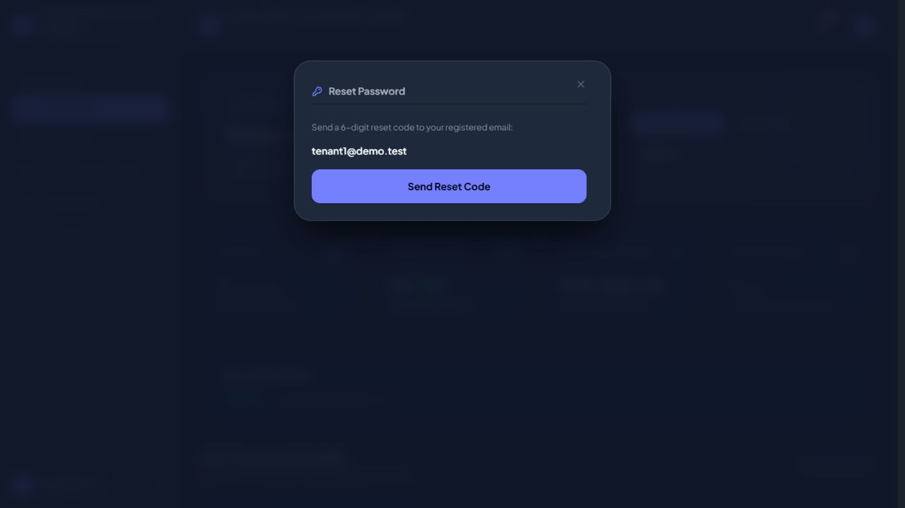
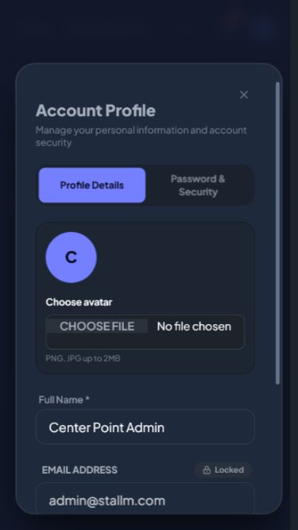

# Profile and security follow-up

Profile is now a persistent client-controlled dialog. Its two panels switch locally, and it shares the auth dialog's fixed top anchor and modal animations. Dismissal resets password visibility and discards unsaved values through the existing server close method. Avatar selection has one labelled file input beside the preview on desktop and stacks on mobile. Selected photos validate immediately.

Admin 2FA appears first in Password & Security with an accessible switch. It sends an enrollment code when off; enabling still requires code verification. When on, the switch reveals the password confirmation required to disable it. Password fields in profile, 2FA confirmation, and recovery have reveal icons.

The profile recovery link reads Forgot Password. Signed-in recovery displays the registered account email without an editable field or Back to Sign In. Both opening and requesting a reset enforce the authenticated user's email on the server. Guest recovery retains its email input and navigation.

- Hard Gate PASS for scope: browser checked account menu opening, profile/security tab switching at the same y=86.4px, current-password reveal, recovery transition with fixed account email, and profile closing. At 375px, modal clientWidth=scrollWidth=324px and file input width=250.4px. Admin 2FA visually confirmed above password fields at desktop width; screenshots saved.
- Purpose Gate PASS: local switches remove tab round trips; avatar control no longer duplicates selection actions; signed-in recovery targets the existing account.
- Liveliness PASS for preservation: existing theme retained; ENERGY 1 / RHYTHM 1 / MOTION 1.
- Craftsmanship PASS: production build succeeds. 17 profile/2FA/hardening tests passed with 77 assertions, followed by 6 profile tests with 19 assertions after adding email-tampering coverage. git diff --check passes. No real passwords or 2FA settings were changed; reset delivery tests used a mock mailer.

Browser checks exposed and corrected a null event-detail error before final verification. No server-backed financial or unrelated modal workflows were changed by this follow-up.

