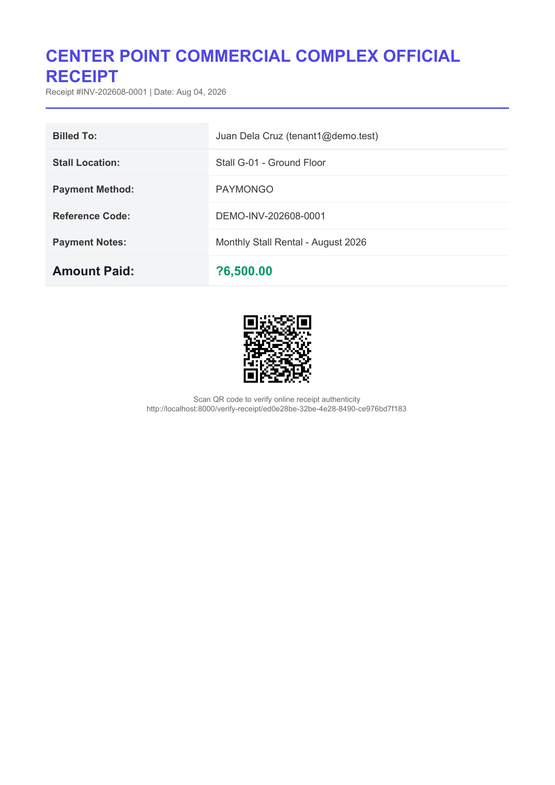
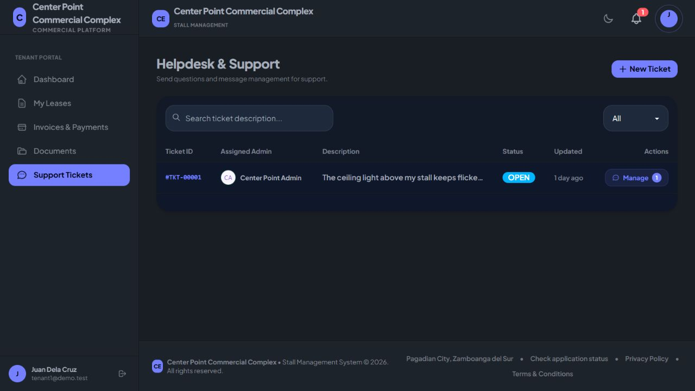

# Receipt QR and sidebar follow-up

Receipt QR output used raw inline SVG, which Dompdf does not render as an HTML image. The fallback used a remote image although remote access was disabled in the PDF renderer. Installed bacon/bacon-qr-code 3.1.1 and replaced the remote generator with local SVG generation. The PDF embeds that SVG through a base64 data-image source while retaining remote access restrictions.

The desktop drawer changes to block layout, so its overlay button occupied a 24px line above the sidebar. The overlay is now hidden at the desktop breakpoint, preserving the mobile drawer control.

- Hard Gate PASS for scope: generated and rendered receipt 2; visually confirmed the QR and decoded the rendered image to its UUID verification URL. Browser measured sidebar top changing from 24px to 0px on the support page at 1280px; desktop overlay display is none.
- Purpose Gate PASS: receipt verification is usable without an external QR request; desktop sidebar starts flush with the viewport.
- Liveliness PASS for preservation: existing styles retained; ENERGY 1 / RHYTHM 1 / MOTION 1.
- Craftsmanship PASS: production build, Composer validation, git diff --check, and 9 receipt/service tests with 24 assertions pass. Composer's slow optimized classmap rebuild was stopped and the normal autoloader regenerated successfully; the project's optimize-autoloader setting remains true.

The local test receipt uses the configured localhost URL. Deployment must use its real reachable URL for scanning from other devices.

