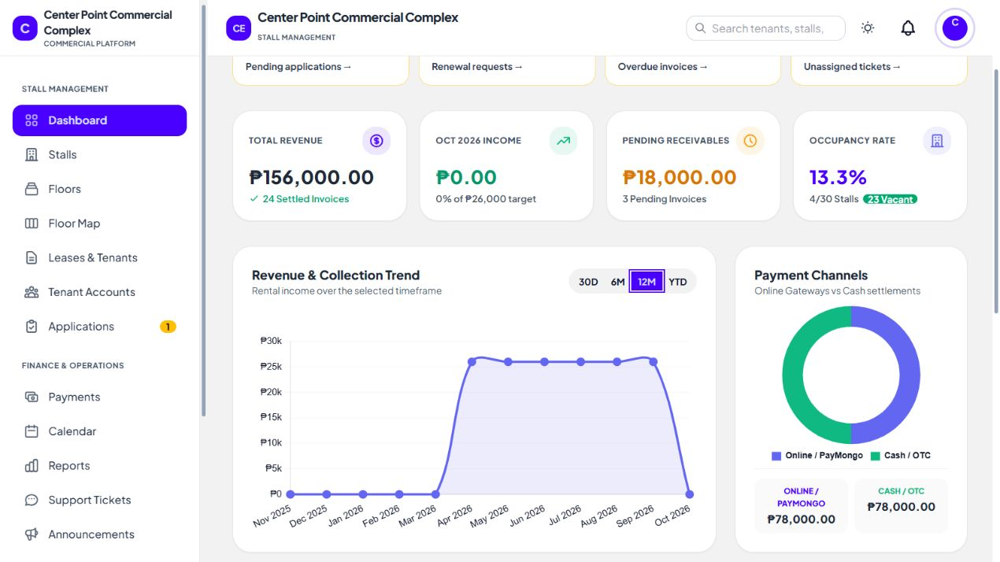
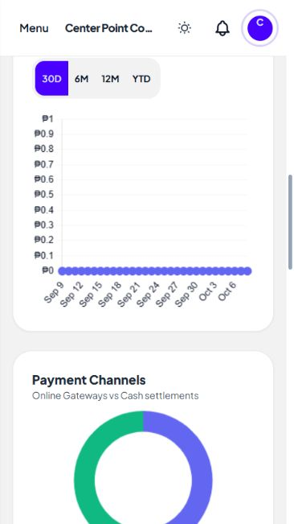

# Revenue chart follow-up

Reproduced both canvases resetting to their browser default 300x150 size and losing their drawings after selecting 30D. Livewire was morphing Chart.js-owned canvas attributes, while the old redraw code only listened for document load/navigation and captured the initial data.

Chart.js now loads once through Livewire assets and initializes per dashboard component. Canvas elements use wire:ignore; component events update existing chart datasets without recreating the canvases. Navigation destroys the instances and theme observer. Chart text follows the current theme, and updates have no decorative animation.

30D now groups the last 30 calendar days, including the previous month. Monthly ranges start on the first day before subtracting months to avoid skipping February at month-end. Future dates are excluded. Empty revenue/payment states have explanatory text.

Reading this as: financial analytics for stall administrators, preserving the portal's visual language, ENERGY 1 / RHYTHM 1 / MOTION 1.

- Hard Gate PASS for scope: browser clicks verified 30D, 6M, 12M and YTD with both charts still drawn; leaving for Payments and returning rebuilt the charts. Responsive check at 375x667 showed document clientWidth=scrollWidth=366px and canvases fitting their 284px containers. Keyboard Enter selected 12M. Final code produced no new console errors after the intermediate initialization fix.
- Purpose Gate PASS: canvas ownership and component-scoped updates preserve chart drawings; daily buckets match the 30D label; theme-derived text keeps chart labels readable. No new assets, decorative icons or invented metrics.
- Liveliness PASS for preservation: existing revenue hierarchy and line/channel color distinction retained with 1/1/1 dials.
- Craftsmanship PASS: production build and whitespace checks passed; 14 relevant tests passed with 38 assertions covering 30-day boundaries, month-end ranges, chart event data, empty states, payment totals and dashboard metrics. Light/dark theme switching was checked and the original dark theme restored; viewport override reset.

