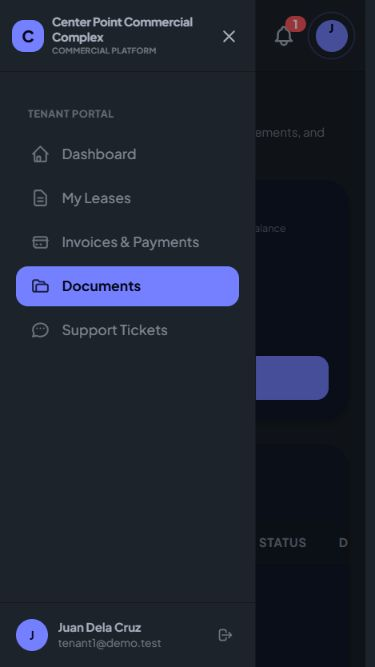
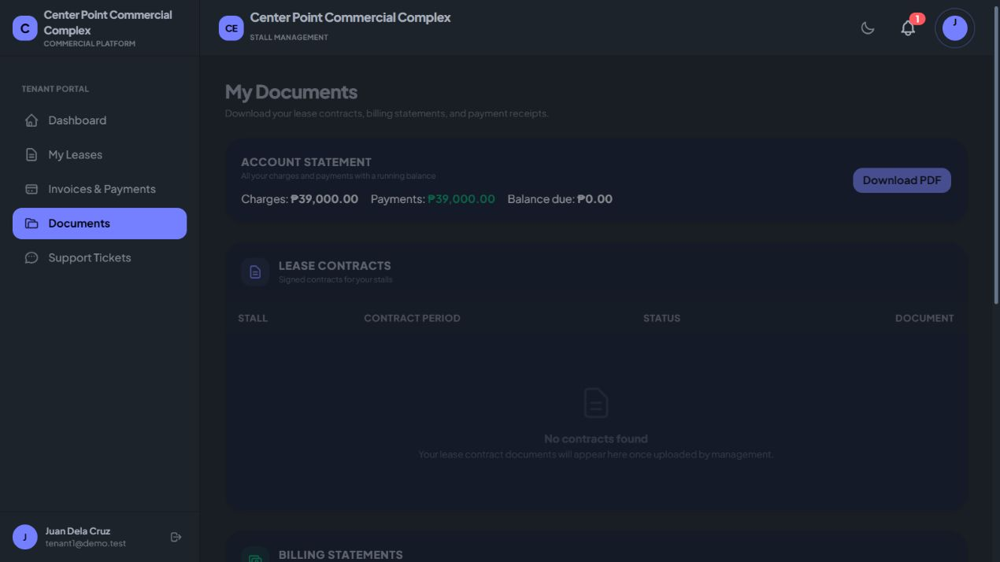

# Sidebar header follow-up

Replaced the mobile Close menu text with a labelled X icon, placed inside the brand header rather than as a third flex child. The third child previously caused justify-between to distribute a large blank space above branding. Both the navbar and sidebar brand header now use a shared 72px height, aligning their bottom borders. Compact sidebar typography allows the full brand name to fit beside the mobile close control.

- Hard Gate PASS for scope: desktop browser measured both dividers at y=72px. At 375x667 the brand header starts at y=0, the X has a 44x44px target, and closing returns focus to Menu and marks the sidebar inert. Temporary viewport override reset.
- Purpose Gate PASS: close control is compact; branding starts at the top; header borders line up.
- Liveliness PASS for preservation: existing theme and branding retained; ENERGY 1 / RHYTHM 1 / MOTION 1.
- Craftsmanship PASS: production build and git diff --check pass. No tests added for this reversible presentation adjustment; actual desktop/mobile browser checks cover the changed layout and close behavior.

