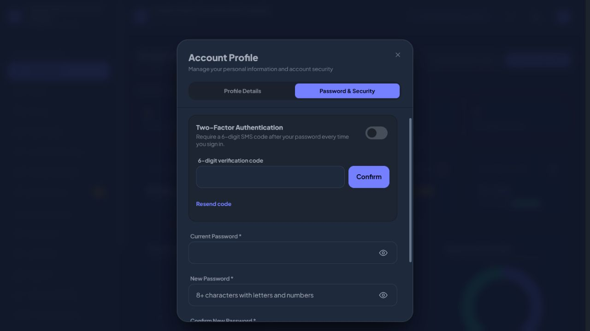
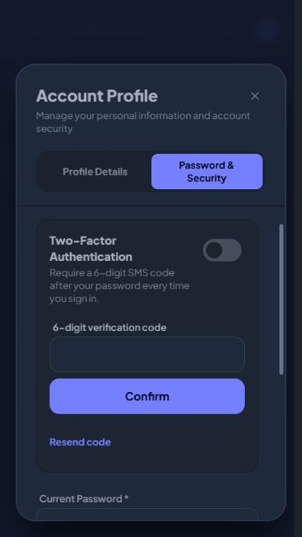

# Two-factor interaction follow-up

Reproduced the 2FA enrollment request on the running dashboard. Before the fix, a Livewire response removed the native dialog open attribute, causing the modal manager to reopen it and move focus to Close. The switch also lost focus when disabled during the request.

The profile dialog now uses `wire:ignore.self` so its native open state and Alpine-owned root attributes survive server updates while its contents still update. The verification panel stays mounted. Requests have an immediate sending status and a duplicate-request guard; the switch and resend control retain focus through pending states. Confirm aligns with the code input on desktop and stacks on mobile. A successful resend clears stale code errors.

Reading this as: account security settings for stall administrators, preserving the existing commercial portal style, ENERGY 1 / RHYTHM 1 / MOTION 1. No new animation, palette, assets, or security behavior.

- Hard Gate PASS for scope: real browser enrollment request retains switch focus and open state; desktop header remains at y=111.20px before and after. At 375x667, body clientWidth and scrollWidth are both 324px, scrollTop remains 0, and header y=104.86px. Loading, verification, and resend cooldown states are present. No console errors in the tested tab.
- Purpose Gate PASS: persistent dialog attributes prevent a close/reopen flash; persistent fields prevent replacement; sending text explains request latency; aligned controls connect the code and confirmation action.
- Liveliness PASS for preservation: existing typography, purple accent, and security grouping retained with declared 1/1/1 dials.
- Craftsmanship PASS: production Vite build and diff whitespace check pass; 13 profile/enrollment tests pass with 51 assertions, including invalid code, successful confirmation, password-protected disabling, and clearing an old error on resend.

Browser verification stopped before confirming enrollment, so the signed-in account's 2FA setting was not changed. SMS requests used the application's local development catcher. Enrollment/disable completion was covered by isolated automated tests.

